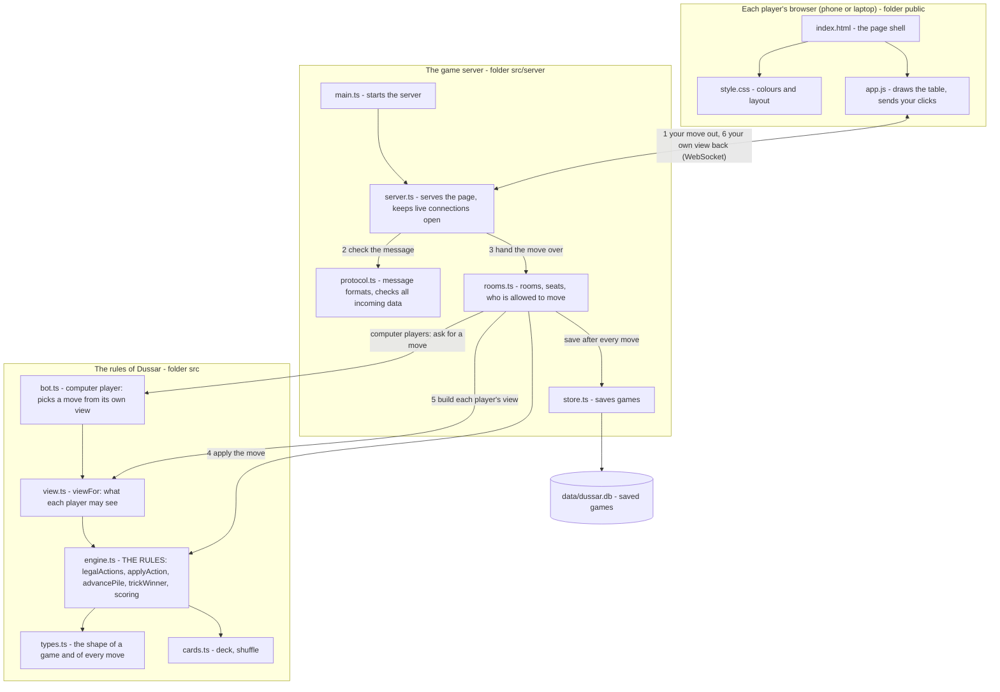

# Dussar

An online version of the Himachal Pradesh card game Dussar (a "Double Sir" variant) for four players in different places.
Win two tricks in a row to collect the cards. First team to 104 points wins.

## Run it on your own computer

You need [Node.js](https://nodejs.org) version 22.13 or newer.

    npm install
    npm start

Then open http://localhost:3000 in a browser. Create a room, and open the link on three more devices
(or three more browser windows) to join.

## Computer players

In the lobby, tap **Add computer** on any empty seat. A computer player sees only what a human in that seat
would see, so it cannot cheat. It lives in `src/bot.ts`.

## Putting it online (Render)

The file `render.yaml` tells [Render](https://render.com) how to run the game. In Render choose
**New, then Blueprint**, pick this repository, and click **Apply**. You get a web address to share.

The free plan sleeps after 15 quiet minutes and forgets saved games when it restarts. While anyone has the game page
open it pings the server every 4 minutes to stay awake. For games that must survive overnight, use a paid
plan with a persistent disk and set `DUSSAR_DB` to a file on that disk.

## Check that everything works

    npm test            runs all the automated checks
    npm run typecheck   looks for typing mistakes

## How the program fits together

(The same diagram as a picture: `docs/architecture.png`. To paste it into Miro, copy the text of
`docs/architecture.mmd` and paste it onto a Miro board.)

## Folders

| Folder | What is in it |
| --- | --- |
| `src/` | The rules of the game: `cards.ts`, `types.ts`, `engine.ts`, `view.ts`, and the computer player `bot.ts` |
| `src/server/` | The server: `main.ts`, `server.ts`, `protocol.ts`, `rooms.ts`, `store.ts` |
| `public/` | The web page each player sees: `index.html`, `style.css`, `app.js` |
| `tests/` | Automated checks written from the rules document |
| `docs/` | The schematic |
| `data/` | Created automatically: the saved games (not uploaded to GitHub) |

More detail on the rule choices is in `NOTES.md`.
